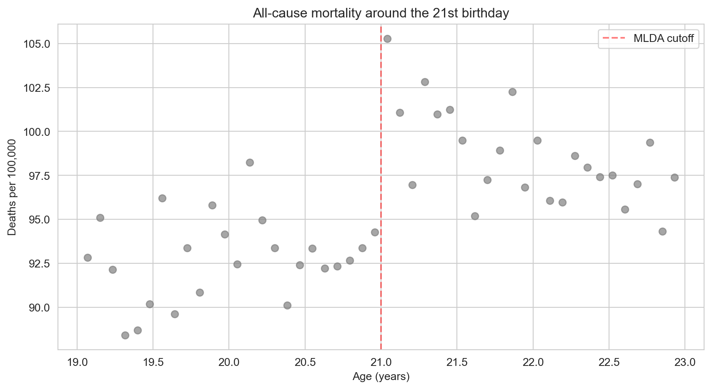
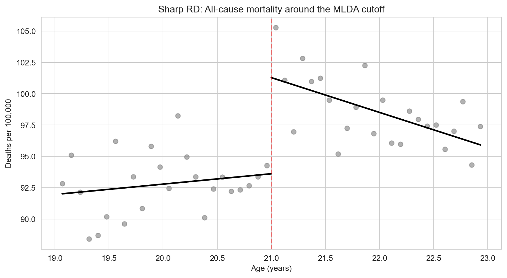
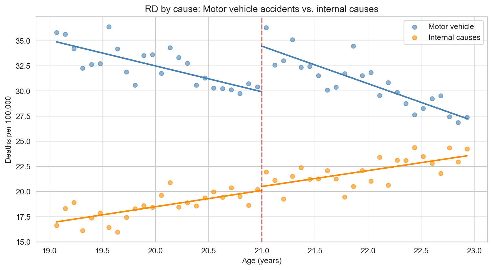

# The Question {.divider background-color="#3498db"}

[Act I]{.act}

## Does gaining legal access to alcohol make young people more likely to die?

In the United States, the **minimum legal drinking age (MLDA)** is 21.

. . .

Should it be lower? If legal access raises deaths, a birthday rule is a life-and-death policy lever.

::: {.notes}
Open with the policy question. Ask the room: would lowering the MLDA cost lives? Bright lines are everywhere: voting at 18, Medicare
eligibility at 65, legal drinking at 21. This chapter shows how to turn such lines into evidence.
:::

## Rigid rules look like the enemy of experiments — yet they create one

- A bureaucratic cutoff seems to leave **nothing to chance**
- But someone aged 20 years and 11 months is a near twin of someone aged 21 and 1 month
- Only one of them may legally buy a drink

[Near the line, the rule — not the person — decides who is treated.]{.takeaway .fragment}

::: {.notes}
Finish-line analogy: a sprinter at 9.99 seconds and one at 10.01 seconds are equally talented, but
only one gets the medal. The medal is the treatment, assigned by the line. A cutoff therefore mimics
a lottery for the people standing right next to it.
:::

## Monthly death rates step up right at the 21st birthday



::: {.notes}
Each dot is one month of age. Below 21 the rates sit in the low-to-mid 90s; the cells just after 21
are among the highest in the sample. Ask: is this a coincidence of age, or the effect of legal access? The rest of the
lecture makes that judgement rigorous.
:::

## Our route through the chapter

::: {.incremental}
- **The question** — how a birthday rule can act like a natural experiment
- **The investigation** — the sharp RD design and regression; the MLDA mortality case study;
  robustness checks; fuzzy RD and Boston's exam schools
- **The resolution** — what RD can and cannot claim, and the traps to avoid
:::

::: {.notes}
Learning objectives: explain how cutoffs create natural experiments; define running variable,
cutoff, and treatment indicator; distinguish sharp and fuzzy RD; estimate effects with polynomial
regression at a discontinuity; check robustness with bandwidth and specification choices; interpret
RD as a local effect at the cutoff.
:::

## Three ingredients define every RD design

:::: {.columns}
::: {.column width="33%"}
### Running variable
The continuous score that decides treatment — here, **age** $a$.
:::
::: {.column width="33%"}
### Cutoff
The value where treatment switches — here, **21**.
:::
::: {.column width="34%"}
### Treatment indicator
$D_a = 1$ at or above the cutoff, $0$ below it.
:::
::::

[Name these three and you have described the design.]{.takeaway .fragment}

::: {.notes}
Other cutoffs: an exam score of 70 for passing, age 65 for Medicare, an income limit for a
benefit. In the data, age is `agecell` (or `age`, centred at 21) and the treatment dummy is `over21`.
:::

## Four more words we will use all lecture

::: {.small-table}
| Term | Plain meaning |
|:---|:---|
| **Sharp vs. fuzzy RD** | Treatment flips fully at the cutoff vs. only its *probability* jumps |
| **Continuity assumption** | Without treatment, outcomes would pass smoothly through the cutoff |
| **Bandwidth** | How far from the cutoff we let the data reach |
| **Placebo test** | Check an outcome that *should not* jump — it must stay flat |
:::

[Sharp/fuzzy says how treatment moves; the other three keep the jump honest.]{.takeaway .fragment}

::: {.notes}
Analogies: sharp RD is a light switch, fuzzy RD a dimmer. Continuity is a smooth road — a sudden
bump means something was placed there. Bandwidth is zooming a photo in or out. A placebo test is
checking that a medicine does not change hair colour.
:::

# The Investigation {.divider background-color="#8e44ad"}

[Act II]{.act}

## At the cutoff, drinkers and non-drinkers never share an age

| Age | Legal access to alcohol |
|:---|:---:|
| 20 years, 11 months | 0% |
| 21 years, 0 months | [100%]{.key} |

. . .

There is **no age** at which we can compare treated and untreated people side by side.

[RD has no overlap — so it cannot work by matching people with the same age.]{.takeaway .fragment}

::: {.notes}
In Chapter 2, regression compared treated and untreated people with the same values of the
controls. Here that is impossible: everyone over 21 is treated, everyone under 21 is not. The design
must lean on something else — the shape of the trend on each side.
:::

## RD does not "control for" age — it extrapolates each side to the line

:::: {.columns}
::: {.column width="50%"}
### Regression with controls
- Compare treated and untreated **at the same** value of a control
- Needs both groups at every value
:::
::: {.column width="50%"}
### Regression discontinuity
- Fit the trend **separately** on each side
- Project both trends to 21 and read the gap
:::
::::

[Because RD extrapolates, the shape of the fitted trend matters.]{.takeaway .fragment}

::: {.notes}
This is the chapter's main misconception. A straight line projected to 21 and a curved line
projected to 21 can land at different heights — which is why we will vary the functional form later.
:::

## A birthday flips legal access from 0 to 1

$$D_a = \begin{cases} 1 & \text{if } a \geq 21 \\ 0 & \text{if } a < 21 \end{cases}$$

[$a$ is age (the running variable, `agecell`); $D_a$ is the treatment switch (`over21`).]{.comment}

[Treatment is a deterministic function of age: no exceptions, no choice — a **sharp** RD.]{.takeaway .fragment}

::: {.notes}
Sharp means the probability of treatment goes from 0% to 100% at the cutoff. Nobody can pick their
birthday, which also rules out people sorting themselves to one side of the line.
:::

## Age shapes death rates smoothly; only legal access can jump at 21

```{mermaid}
graph LR
    A["Age (running variable)"] -->|"crosses 21"| D["Legal access"]
    D -->|"jump?"| M["Death rate"]
    A -->|"smooth trend"| M
    style A fill:#2c3e50,color:#fff
    style D fill:#8e44ad,color:#fff
    style M fill:#2d8659,color:#fff
```

[Age has a smooth path to mortality; the legal-access path is the only one that can create a break.]{.takeaway .fragment}

::: {.notes}
Age affects mortality directly (maturity, driving experience, lifestyle) — but gradually, month by
month. Legal access changes abruptly at 21. If we model the smooth part, what remains at 21 is the
causal effect.
:::

## Continuity: without the policy, mortality would glide through 21

- Every other influence on death rates changes **smoothly** with age
- So the outcome trend, absent treatment, has **no break** at 21
- Any break we see must come from the treatment

[A speed bump on a smooth road means someone put it there.]{.takeaway .fragment}

::: {.notes}
The continuity assumption is the identifying assumption of RD. It fails if something else also
switches at 21 — a different law, an insurance rule, a change in how deaths are recorded. Placebo
outcomes, later, are how we probe it.
:::

## Plot first: a scatter with a line at 21 shows the jump before any model

``` {.python code-line-numbers="1-2|4-6|8-11"}
import pandas as pd                       # pandas → load tables
import matplotlib.pyplot as plt           # matplotlib → draw the scatter

# every course dataset lives in the repo's data/ folder on GitHub
GITHUB_DATA_URL = "https://raw.githubusercontent.com/cmg777/intro2causal/main/data/"
mlda = pd.read_csv(GITHUB_DATA_URL + "ch4/mlda_clean.csv")   # monthly age cells

fig, ax = plt.subplots(figsize=(8, 4.5))                      # one blank panel
ax.scatter(mlda["agecell"], mlda["all"], color="gray")        # death rate vs. age
ax.axvline(21, color="red", linestyle="--")                   # mark the cutoff
plt.show()                                                    # the step at 21 appears
```

[↗ Try it in Colab](https://colab.research.google.com/notebooks/empty.ipynb){.colab-link target="_blank" data-preview-link="false"}

::: {.notes}
Visual inspection is the most important step in RD. If you cannot see a jump in the raw scatter, be
suspicious of any regression that claims one. `agecell` is age in years; `all` is deaths per 100,000
from all causes. Add `ax.set_xlabel("Age (years)")` and `ax.set_ylabel("Deaths per 100,000")` for
labels.
:::

## One regression measures the jump while holding the age trend fixed

$$M_a = \alpha + \rho \, D_a + \gamma \, a + e_a$$

:::: {.columns}
::: {.column width="50%"}
- $\rho$ = **jump at the cutoff** — the causal effect
- $\gamma$ = the smooth age trend
:::
::: {.column width="50%"}
- $M_a$ = death rate (`all`); $D_a$ = `over21`
- $a$ = age centred at 21 (`age`)
:::
::::

[The dummy captures the break; the age term absorbs the smooth slope.]{.takeaway .fragment}

::: {.notes}
With age centred at 21 (age = agecell − 21), the intercept α is the predicted death rate just below
the cutoff and α + ρ the rate just above. In code: pf.feols("all ~ over21 + age", vcov="hetero").
:::

## The vertical gap between the two fitted lines at 21 is the effect



::: {.notes}
Each side gets its own line. Left of 21 the line rises gently; right of 21 it starts much higher and
slopes down. If legal access did nothing, the two lines would meet at 21. They do not — the gap is
the RD estimate.
:::

## The data: 48 monthly age cells around the 21st birthday

::: {.small-table}
| Column | Meaning |
|:---|:---|
| `agecell` | Age in years, one cell per month (19 to 23) |
| `age` | Age centred at 21 (0 = the cutoff) |
| `over21` | Treatment dummy: 1 if 21 or older |
| `all`, `mva`, `suicide`, `internal`, `alcohol` | Deaths per 100,000, by cause |
| `age2`, `over_age`, `over_age2` | Terms for the quadratic model |
:::

[Each row is an age, not a person: 24 cells below 21 and 24 above.]{.takeaway .fragment}

::: {.notes}
US mortality data aggregated into monthly age cells. `mva` = motor-vehicle accidents; `internal` =
deaths from disease (cancer, heart disease, and so on). The extra polynomial columns are pre-built
so the quadratic regression is a one-liner. The CSV has 50 rows, but the two rows at exactly 21
are empty placeholders, so every regression uses 48 cells (pyfixest drops the empty rows).
:::

## One `pf.feols` call estimates the sharp RD

``` {.python code-line-numbers="1|3-4|6-7|9-11"}
!pip install -q pyfixest                  # pyfixest is not preinstalled in Colab

import pandas as pd                       # pandas → load tables
import pyfixest as pf                     # pyfixest → regressions with robust SEs

GITHUB_DATA_URL = "https://raw.githubusercontent.com/cmg777/intro2causal/main/data/"
mlda = pd.read_csv(GITHUB_DATA_URL + "ch4/mlda_clean.csv")   # MLDA age cells

# death rate on the over-21 switch plus a linear age trend, robust SEs
m = pf.feols("all ~ over21 + age", data=mlda, vcov="hetero")
m.summary()                               # over21 = 7.66 (SE 1.51); Intercept 91.84
```

[↗ Try it in Colab](https://colab.research.google.com/notebooks/empty.ipynb){.colab-link target="_blank" data-preview-link="false"}

::: {.notes}
`vcov="hetero"` gives heteroskedasticity-robust standard errors. The over21 coefficient is the jump
ρ; the intercept is the predicted death rate just below 21; the age slope (−0.97, SE 0.66) is the
common trend. t ≈ 5.1 on over21; 48 age cells are used.
:::

## Legal access to alcohol raises the death rate at 21 {background-color="#8e44ad"}

[+7.7]{.bignum}

[extra deaths per 100,000 at the 21st birthday — about 8% above the 91.8 just below]{.bignum-label}

::: {.notes}
7.66 / 91.84 ≈ 0.083, so an 8% increase in the all-cause death rate, from a single birthday. Robust
SE 1.51, t ≈ 5.1 — far beyond noise.
:::

## Motor-vehicle accidents carry most of the jump

| Cause of death | Jump at 21 (SE) |
|:---|---:|
| All causes | 7.66 (1.51) |
| Motor-vehicle accidents | [4.53 (0.72)]{.key} |
| Suicide | 1.79 (0.50) |
| Alcohol-related (direct) | 0.44 (0.21) |
| Internal causes (disease) | 0.39 (0.54) |

[More than half the extra deaths happen on the road — drunk driving is the main channel.]{.takeaway .fragment}

::: {.notes}
Linear RD on the full sample, robust SEs, one regression per cause. Across specifications the
motor-vehicle jump ranges from about 4.5 to 5.9. Direct alcohol poisoning is small but significant;
suicide is modest. Comparing causes is how RD reveals mechanisms.
:::

## Diseases ignore the birthday: internal causes do not jump



[A placebo outcome that stays flat makes the motor-vehicle jump believable.]{.takeaway .fragment}

::: {.notes}
Cancer and heart disease develop over years; nothing biological happens to them on a 21st birthday.
If internal-cause deaths jumped, something else must change at 21 (record-keeping, insurance rules),
and we could not trust the motor-vehicle result either. Linear estimate 0.39 (SE 0.54): no jump.
:::

## Swapping the outcome turns the same regression into a placebo test

``` {.python code-line-numbers="1-3|5-6|8-11"}
!pip install -q pyfixest                  # pyfixest is not preinstalled in Colab
import pandas as pd                       # pandas → load tables
import pyfixest as pf                     # pyfixest → regressions with robust SEs

GITHUB_DATA_URL = "https://raw.githubusercontent.com/cmg777/intro2causal/main/data/"
mlda = pd.read_csv(GITHUB_DATA_URL + "ch4/mlda_clean.csv")   # MLDA age cells

for y in ["mva", "internal"]:             # a real channel, then a placebo
    m = pf.feols(f"{y} ~ over21 + age", data=mlda, vcov="hetero")   # same RD
    print(y, round(m.coef()["over21"], 2), round(m.se()["over21"], 2))
# mva 4.53 0.72  ·  internal 0.39 0.54
```

[↗ Try it in Colab](https://colab.research.google.com/notebooks/empty.ipynb){.colab-link target="_blank" data-preview-link="false"}

::: {.notes}
The f-string swaps the left-hand variable; everything else is identical. We hope for a large
coefficient on `mva` and a small one on `internal`. Try `suicide`, `alcohol`, or `homicide` too.
:::

## A quadratic lets each side of the cutoff bend in its own way

$$M_a = \alpha + \rho D_a + \gamma_1 a + \gamma_2 a^2 + \delta_1 a D_a + \delta_2 a^2 D_a + e_a$$

[Code names: $a^2$ = `age2`, $a D_a$ = `over_age`, $a^2 D_a$ = `over_age2`.]{.comment}

[If the jump survives a curved trend, it is not an artefact of forcing a straight line.]{.takeaway .fragment}

::: {.notes}
A straight ruler may miss a curve; a bendable ruler follows it. The interaction terms (δ) allow the
slope and curvature to differ on each side of 21. ρ is still the gap between the two curves at the
cutoff, because age is centred there.
:::

## Narrowing the window trades precision for comparability

| Window around 21 | Age cells | Jump (SE) |
|:---|---:|---:|
| Full sample (19 to 23) | 48 | 7.66 (1.51) |
| ± 1.5 years | 36 | 8.70 (1.63) |
| ± 1.0 year | 24 | [9.75 (2.06)]{.key} |
| ± 0.5 years | 12 | 8.88 (3.03) |

[Closer cells are more alike, but fewer cells mean noisier estimates — the jump stays between 7.7 and 9.8.]{.takeaway .fragment}

::: {.notes}
Linear RD on all-cause mortality. A narrow bandwidth reduces bias from a mis-specified trend far
from the cutoff; a wide one reduces variance. The standard error doubles from 1.51 to 3.03 as the
window shrinks to half a year on each side. Reporting several bandwidths is standard practice.
:::

## Robustness checks reuse the same call with a new formula or sample

``` {.python code-line-numbers="1-3|5-6|8|10-13"}
!pip install -q pyfixest                  # pyfixest is not preinstalled in Colab
import pandas as pd                       # pandas → load tables
import pyfixest as pf                     # pyfixest → regressions with robust SEs

GITHUB_DATA_URL = "https://raw.githubusercontent.com/cmg777/intro2causal/main/data/"
mlda = pd.read_csv(GITHUB_DATA_URL + "ch4/mlda_clean.csv")   # MLDA age cells

narrow = mlda[(mlda["agecell"] >= 20) & (mlda["agecell"] <= 22)]   # ages 20–22 only

# interacted quadratic trend on the narrow window, robust SEs
m = pf.feols("all ~ over21 + age + age2 + over_age + over_age2",
             data=narrow, vcov="hetero")
m.summary()                               # over21 = 9.61 (SE 2.29)
```

[↗ Try it in Colab](https://colab.research.google.com/notebooks/empty.ipynb){.colab-link target="_blank" data-preview-link="false"}

::: {.notes}
Two knobs: the formula (linear vs. interacted quadratic) and the data (full vs. narrow window).
Change `data=narrow` to `data=mlda` for the quadratic on the full sample (9.55, SE 1.83), or drop the
quadratic terms for the linear narrow fit (9.75, SE 2.06).
:::

## In every specification, deaths from all causes jump by 7 to 10

::: {.small-table}
| Cause of death | Linear, wide | Quad., wide | Linear, narrow | Quad., narrow |
|:---|---:|---:|---:|---:|
| All causes | [7.66 (1.51)]{.key} | [9.55 (1.83)]{.key} | [9.75 (2.06)]{.key} | [9.61 (2.29)]{.key} |
| Motor-vehicle | 4.53 (0.72) | 4.66 (1.09) | 4.76 (1.08) | 5.89 (1.33) |
| Suicide | 1.79 (0.50) | 1.81 (0.78) | 1.72 (0.73) | 1.30 (1.14) |
| Internal causes | 0.39 (0.54) | 1.07 (0.80) | 1.69 (0.74) | 1.25 (1.01) |
| Alcohol-related | 0.44 (0.21) | 0.80 (0.32) | 0.74 (0.33) | 1.03 (0.41) |
:::

[Wide window = all ages 19 to 23; narrow window = ages 20 to 22. Quad. = interacted quadratic. Robust SEs in parentheses.]{.comment}

[Polynomial order and bandwidth move the estimate a little — never the conclusion.]{.takeaway .fragment}

::: {.notes}
Deaths per 100,000; robust standard errors in parentheses. The motor-vehicle jump is 4.5–5.9 in all
four columns. Be honest about the placebo row: internal causes are insignificant in three of four
columns, but the linear narrow-window fit gives 1.69 (0.74). One flag among many comparisons is
expected by chance, and it is far smaller than the all-cause jump — but it is worth naming.
:::

## When the cutoff only raises the odds of treatment, the RD is fuzzy

```{mermaid}
graph LR
    Z["Score above cutoff"] -->|"first stage"| D["Attends exam school"]
    O["Declines or other route"] --> D
    D -->|"effect?"| Y["Achievement"]
    style Z fill:#3498db,color:#fff
    style O fill:#e67e22,color:#fff
    style D fill:#8e44ad,color:#fff
    style Y fill:#2d8659,color:#fff
```

[Crossing the line makes treatment more likely, not certain — a dimmer, not a switch.]{.takeaway .fragment}

::: {.notes}
In a fuzzy RD some people above the cutoff go untreated and some below it get treated anyway. The
cutoff dummy no longer *is* the treatment — it shifts the probability of treatment.
:::

## Fuzzy RD is instrumental variables at a cutoff

$$\text{Effect} \;=\; \frac{\text{Jump in the outcome at the cutoff}}{\text{Jump in the probability of treatment at the cutoff}}$$

[Reduced form ÷ first stage — the Wald ratio from Chapter 3, with the cutoff dummy as instrument.]{.comment}

[If you understand IV, you already understand fuzzy RD.]{.takeaway .fragment}

::: {.notes}
Estimate it by 2SLS: the above-cutoff dummy instruments actual treatment, while the running
variable's trend stays in the model. In pyfixest the IV syntax is the one from Chapter 3:
outcome ~ controls | treatment ~ instrument. Chapter 6 works through a fuzzy-RD example in code.
:::

## Sharp and fuzzy RD answer slightly different questions

| | Sharp RD | Fuzzy RD |
|:---|:---|:---|
| At the cutoff | Treatment switches fully | Probability of treatment jumps |
| Estimation | OLS with the running-variable trend | 2SLS, cutoff dummy as instrument |
| Interpretation | Effect of treatment at the cutoff | [LATE for compliers at the cutoff]{.key} |

[Fuzziness adds one step — scaling by the first stage — and narrows *who* the effect describes.]{.takeaway .fragment}

::: {.notes}
Compliers here are the students who attend the exam school because they cleared the cutoff and would
not have attended otherwise. As with LATE in Chapter 3, the estimate is for them, not for everyone.
:::

## Boston's exam schools admit by test score — but admission is not enrollment

- Elite public high schools take applicants above an **admissions-score cutoff**
- Some admitted students **decline**; some below the line get in **by other routes**
- So the cutoff shifts the *chance* of attending — a fuzzy RD

[Comparing applicants just above and just below the cutoff isolates the effect of the school itself.]{.takeaway .fragment}

::: {.notes}
Applicants just either side of the score cutoff are similar in ability and motivation. Raw
comparisons of exam-school and regular-school students, by contrast, mix the school's effect with
the very different students each school admits.
:::

## At the cutoff, classmates get much stronger — test scores do not

| What changes at the admissions cutoff | Jump |
|:---|:---:|
| Peer quality (classmates' ability) | [+0.8 SD]{.key} |
| Admitted students' own achievement | No jump |

[Better peers did not translate into better results for students at the margin.]{.takeaway .fragment}

::: {.notes}
Research on Boston's exam schools found that peer quality rose by about 0.8 standard deviations at
the cutoff, yet student achievement showed no matching jump. This challenges the belief that
attending a more selective school, with higher-ability peers, causally raises achievement.
:::

## The exam-school advantage in raw data is mostly selection

- Exam-school students score far higher than other students
- RD shows the **school** adds little at the margin
- The raw gap reflects **who gets in**, not what the school does

[Selection bias again: strong correlations between school quality and outcomes need not be causal.]{.takeaway .fragment}

::: {.notes}
Policy implication: reallocating students across schools of different selectivity may not raise
achievement, even though the cross-sectional correlation is strong. Same lesson as Chapter 1's
insured vs. uninsured comparison.
:::

## RD estimates are local: they describe people near the cutoff

- The MLDA estimate applies to people **turning 21**
- At 18 or 25 the effect could be larger or smaller
- Going further from the line needs assumptions the data cannot check

[RD buys strong internal validity at one margin, at the cost of reach.]{.takeaway .fragment}

::: {.notes}
Lake-shore analogy: depth measured at the shoreline is accurate there, but the lake may be much
deeper further out. Like LATE in IV, RD trades external validity for credibility at a specific
margin.
:::

## RD was born in 1960, at a scholarship cutoff

- **Donald Thistlethwaite and Donald Campbell** studied National Merit recognition
- Students just above vs. just below the recognition cutoff
- Finding: recognition barely changed career plans

[One of the first RD studies — of what is now a ubiquitous research design.]{.takeaway .fragment}

::: {.notes}
Campbell went on to pioneer quasi-experimental methods more broadly, co-authoring influential texts
on research design that shaped causal inference outside true experiments.
:::

# The Resolution {.divider background-color="#2d8659"}

[Act III]{.act}

## The tempting mistake: "RD just controls for the running variable"

[Objection.]{.objection} RD is ordinary regression with age as a control.

. . .

[Response.]{.rebuttal} No age has both treated and untreated people, so there is nothing to compare
at equal age. RD **extrapolates** each side's trend to the cutoff — which is why the functional form
and bandwidth must be varied and reported.

::: {.notes}
This is why the robustness grid matters: linear vs. quadratic, wide vs. narrow window. A credible RD
shows the jump survives those choices.
:::

## The tempting mistake: "A jump at 21 proves alcohol kills"

[Objection.]{.objection} Death rates break at 21, and 21 is the drinking age — case closed.

. . .

[Response.]{.rebuttal} Only if nothing else switches at 21. The design earns belief when other
influences stay smooth and **placebo outcomes stay flat** — as internal-cause deaths do.

::: {.notes}
If, say, an insurance rule or a data-recording convention also changed at 21, the jump would mix
several effects. Checking outcomes that should not respond is the guard. Age cannot be manipulated,
which also protects this design; exam scores, by contrast, sometimes can be.
:::

## Key takeaways

::: {.incremental}
- **Cutoff rules** create natural experiments for people near the line
- The effect is the **jump at the cutoff**, net of the smooth trend
- **Plot first**, then vary the polynomial and the bandwidth
- **Placebo outcomes** guard the design; RD estimates are **local**
- **Fuzzy RD** = instrumental variables at a cutoff
:::

::: {.notes}
MLDA: about 7.7 extra deaths per 100,000 at 21 (7–10 across specifications), mostly motor-vehicle
accidents, with no jump in disease deaths. Boston exam schools: peers improved, achievement did not.
:::

## {.recap background-image="figures/visual_summary.svg" background-size="contain" background-color="#0f172a"}

::: {.notes}
Recap with the chapter's visual summary: the question (does legal drinking raise deaths?), the
design (a sharp cutoff at 21), the method (fit each side, read the jump), and the evidence (a jump
of 7–10 deaths per 100,000, driven by car crashes, with a flat placebo).
:::

# When a rule flips treatment at a threshold, the jump right at the line reveals the causal effect for those near it. {.divider background-color="#2d8659"}
