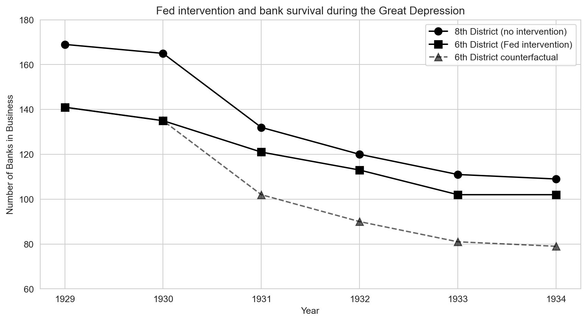

# The Question {.divider background-color="#3498db"}

[Act I]{.act}

## Could a central bank have stopped a banking panic?

In 1930 a Nashville banking giant, Caldwell and Company, collapsed — and bank failures spread
across the American South within weeks.

. . .

If the Federal Reserve had flooded struggling banks with cash, would **more banks have survived**,
or would the Depression have swept them away regardless?

::: {.notes}
Open with the stakes: bank runs are contagious. When one big bank fails, depositors everywhere
panic and pull their money, and even healthy banks can be forced to close. The policy question —
should a central bank act as lender of last resort? — is still debated after every financial crisis
(2008, 2020). Ask the room: would emergency lending have helped, or only delayed the inevitable?
:::

## A Fed district border split Mississippi into two policy regimes

```{mermaid}
graph LR
    S["Caldwell collapse, 1930"] --> A["6th District: Atlanta Fed lends"]
    S --> B["8th District: St. Louis Fed tightens"]
    A --> O["Banks still in business?"]
    B --> O
    style S fill:#c0392b,color:#fff
    style A fill:#8e44ad,color:#fff
    style B fill:#e67e22,color:#fff
    style O fill:#2d8659,color:#fff
```

[Same state, same shock, opposite policies — a natural experiment drawn by a map.]{.takeaway .fragment}

::: {.notes}
The boundary between two Federal Reserve districts runs through the middle of Mississippi. The
Atlanta Fed (6th District, southern half) favoured easy credit and liquidity support for banks in
trouble. The St. Louis Fed (8th District, northern half) followed the restrictive "Real Bills"
doctrine and tightened credit during the crisis. Banks on both sides of the line faced the same
local economy — only the policy differed.
:::

## Even in the rescue district, banks kept disappearing

| Year | 6th District (Atlanta Fed) | 8th District (St. Louis Fed) |
|:---|---:|---:|
| 1930 | 135 | 165 |
| 1931 | 121 | 132 |
| 1933 | [102]{.key} | 111 |

[Mississippi banks in business on July 1 of each year.]{.comment}

[The Atlanta district lost 33 banks by 1933. Did the rescue fail — or would it have been worse?]{.takeaway .fragment}

::: {.notes}
This is the naive evidence. Looking only at the treated district, the picture is grim: 135 banks in
1930, 102 by 1933. A before-after comparison would call the Fed's policy a failure. But the whole
country was in the Great Depression. The real question is how many banks the 6th District would have
had without the easy-credit policy — and that is something we never observe directly.
Full data (banks_clean.csv): 1929 141/169, 1930 135/165, 1931 121/132, 1932 113/120,
1933 102/111, 1934 102/109.
:::

## Our route through the chapter

::: {.incremental}
- **The question** — why one-way comparisons (before vs after, treated vs untreated) mislead
- **The investigation** — the DD formula and parallel trends; the Mississippi banks; regression DD
  with fixed effects; the drinking-age case study and its robustness checks
- **The resolution** — the traps to avoid and what DD can and cannot promise
:::

::: {.notes}
Learning objectives: explain the difference-in-differences strategy; construct a counterfactual
from a control group's trajectory; state and assess the parallel trends assumption; estimate DD
effects with fixed-effects regression; understand why state-specific trends, weighting and
clustered standard errors matter; interpret the banking and drinking-age case studies.
:::

## Three ideas carry the whole chapter

:::: {.columns}
::: {.column width="33%"}
### Counterfactual
The **control group's path** stands in for what the treated group would have done untreated.
:::
::: {.column width="33%"}
### Parallel trends
Without treatment, both groups would have **changed by the same amount** — levels may differ.
:::
::: {.column width="34%"}
### Panel data
The same units tracked over time; **fixed effects** absorb constant gaps; DD gives the **ATT**.
:::
::::

[DD trades the coin flip of an experiment for a borrowed trend.]{.takeaway .fragment}

::: {.notes}
Vocabulary we will use: treatment group vs control group; counterfactual (the unobserved outcome
without treatment); parallel trends; before-after comparison; panel data (units × periods);
fixed effects (state FE absorb permanent differences, year FE absorb common shocks); serial
correlation and clustered standard errors; staggered adoption; ATT — the average treatment effect
on the treated, i.e. the effect for the groups that actually received the policy.
:::

# The Investigation {.divider background-color="#8e44ad"}

[Act II]{.act}

## A before-after change bundles the policy with everything else that happened

$$\underbrace{\text{After} - \text{Before}}_{\text{6th District: } -14 \text{ banks}} \;=\; \text{Policy effect} \;+\; \text{Depression trend}$$

. . .

[From 1930 to 1931 the Atlanta district lost 14 banks — but the Depression was hitting every bank in
the country at the same time.]{.comment}

[With one group, we cannot tell the policy's effect from the times it happened in.]{.takeaway .fragment}

::: {.notes}
The 6th District went from 135 to 121 banks between 1930 and 1931. Some of that decline is the
crisis; some of it may be the policy (positive or negative). A before-after comparison cannot
separate the two. Analogy: you feel better after taking medicine during flu season — but you might
have recovered anyway. We need a comparison group that lived through the same times without the
treatment.
:::

## Your friend's weight change reveals what your diet did

| | Before → after the holidays | Change |
|:---|:---|---:|
| You (on a diet) | gained weight | +2 lbs |
| Your friend (no diet) | gained weight | +7 lbs |
| **Difference in changes** | | [−5 lbs]{.key} |

[Without the diet you would have gained 7 lbs like your friend — so the diet saved you 5.]{.takeaway .fragment}

::: {.notes}
Naive before-after: you gained 2 lbs, so the diet "failed". DD: your friend shows what the holidays
do to someone who doesn't diet (+7). Subtract: 2 − 7 = −5. The diet's effect is 5 lbs less weight
gain. The hidden assumption: without the diet, you would have gained the same 7 lbs as your friend.
That assumption has a name — parallel trends.
:::

## DD subtracts the control group's change from the treated group's change

$$\delta_{DD} = \underbrace{\left(\bar{Y}_{\text{treat, after}} - \bar{Y}_{\text{treat, before}}\right)}_{\text{change in treated}} - \underbrace{\left(\bar{Y}_{\text{control, after}} - \bar{Y}_{\text{control, before}}\right)}_{\text{change in control}}$$

[Two differences: first over time within each group, then across the groups.]{.comment}

[The control group's change is our estimate of what time alone would have done to the treated group.]{.takeaway .fragment}

::: {.notes}
δ_DD is the difference-in-differences estimate. Each bracket is a before-after change for one
group. In the diet example: (+2) − (+7) = −5. In the banking example the outcome Y is the number of
banks in business.
:::

## Differencing twice removes both fixed gaps and common shocks

```{mermaid}
graph LR
    T1["Treated: before"] --> DT["Change in treated"]
    T2["Treated: after"] --> DT
    C1["Control: before"] --> DC["Change in control"]
    C2["Control: after"] --> DC
    DT --> DD["DD estimate"]
    DC --> DD
    style T1 fill:#2c3e50,color:#fff
    style T2 fill:#2c3e50,color:#fff
    style C1 fill:#2c3e50,color:#fff
    style C2 fill:#2c3e50,color:#fff
    style DT fill:#3498db,color:#fff
    style DC fill:#e67e22,color:#fff
    style DD fill:#2d8659,color:#fff
```

[Differencing over time cancels each group's permanent level; differencing across groups cancels
shocks that hit both.]{.takeaway .fragment}

::: {.notes}
First difference (within each group, over time): any fixed characteristic of a group — size,
geography, culture — appears in both "before" and "after" and cancels. Second difference (across
groups): any shock common to both groups — the Depression, a recession, national safety campaigns —
appears in both changes and cancels. What survives is the treatment effect, provided the groups
would otherwise have moved alike.
:::

## If the groups would have trended differently anyway, DD absorbs that gap as bias

$$\delta_{DD} \;=\; \text{Treatment effect} \;+\; \underbrace{\left(\text{Trend}_{\text{treat}} - \text{Trend}_{\text{control}}\right)}_{\text{zero under parallel trends}}$$

[Parallel trends: absent treatment, both groups would have changed by the same amount.]{.comment}

[Parallel trends is the assumption that carries the whole design — and it can never be fully tested.]{.takeaway .fragment}

::: {.notes}
Runners analogy: two runners on parallel tracks may start at different positions, but without any
intervention they run at the same pace. If one suddenly pulls ahead, the intervention caused it.
If one was already speeding up before the intervention, DD will wrongly credit that acceleration to
the treatment. We can check whether trends were parallel *before* treatment, but the assumption is
about the counterfactual *after* — which is never observed.
:::

## DD needs the same trend, not the same level

:::: {.columns}
::: {.column width="50%"}
### Levels in 1930
- Atlanta district: **135** banks
- St. Louis district: **165** banks
- A gap of 30 banks before the crisis
:::
::: {.column width="50%"}
### What DD requires
- No need to close the 30-bank gap
- Only that, without the policy, both would have **lost banks at the same pace**
:::
::::

[Groups can start miles apart; they only need to travel in the same direction at the same speed.]{.takeaway .fragment}

::: {.notes}
A common misconception: "DD needs treatment and control groups that look alike". It does not — the
fixed gap is exactly what the first difference removes. In the one pre-crisis year we have
(1929 → 1930), the 6th District went 141 → 135 (−6) and the 8th 169 → 165 (−4): a small, similar
drift before the panic. One year is thin evidence, but it is reassuring.
:::

## Both districts shrank, but St. Louis shrank far faster



[After 1930 the tight-credit 8th District lost banks much more quickly than the easy-credit 6th.]{.takeaway .fragment}

::: {.notes}
Circles: 8th District (St. Louis, tight credit). Squares: 6th District (Atlanta, easy credit).
Both lines slope down — the Depression hurt everyone. But the 8th District's drop between 1930 and
1931 is much steeper (165 → 132) than the 6th's (135 → 121). The dashed line is the counterfactual
we construct on the next slide.
:::

## The counterfactual puts the Atlanta district on St. Louis's path

$$\text{Counterfactual 6th}_t = 135 + \left(\text{8th}_t - 165\right)$$

::: {.small-table}
| Year | 6th District, actual | 6th District, counterfactual |
|:---|---:|---:|
| 1931 | 121 | 102 |
| 1932 | 113 | 90 |
| 1933 | 102 | 81 |
| 1934 | 102 | 79 |
:::

[The gap between actual and counterfactual is the number of banks the policy kept open.]{.takeaway .fragment}

::: {.notes}
The counterfactual starts the 6th District at its own 1930 level (135) and then subtracts the 8th
District's losses since 1930. This is parallel trends made concrete: "had Atlanta behaved like St.
Louis, it would have lost as many banks as St. Louis did". This is the dashed line in the figure.
:::

## DD: the Atlanta Fed kept roughly 19–23 extra banks alive

| Year | Change in 6th (treated) | Change in 8th (control) | DD (banks saved) |
|:---|---:|---:|---:|
| 1931 | −14 | −33 | [19]{.key} |
| 1932 | −22 | −45 | 23 |
| 1933 | −33 | −54 | 21 |
| 1934 | −33 | −56 | [23]{.key} |

[Changes measured relative to 1930.]{.comment}

[Easy credit saved about 20 banks — and the gap persisted for years after the panic.]{.takeaway .fragment}

::: {.notes}
Each DD is (6th change) − (8th change). 1931: (−14) − (−33) = 19. The effect appears immediately
and stays in the 21–23 range through 1934: banks that survived the initial panic with Fed support
stayed solvent, while illiquid banks that failed in the 8th District did not come back. Relative to
the 1930 stock of 135 banks, ~20 is a large share.
:::

## A few lines of pandas compute the banking DD

``` {.python code-line-numbers="1|3-5|7-9|10"}
import pandas as pd                       # pandas → load and reshape tables

# every course dataset lives in the repo's data/ folder on GitHub
GITHUB_DATA_URL = "https://raw.githubusercontent.com/cmg777/intro2causal/main/data/"
banks = pd.read_csv(GITHUB_DATA_URL + "ch5/banks_clean.csv").set_index("year")

change_6 = banks["bib6"] - banks.loc[1930, "bib6"]   # treated (Atlanta) change since 1930
change_8 = banks["bib8"] - banks.loc[1930, "bib8"]   # control (St. Louis) change since 1930
dd = change_6 - change_8                             # DD = treated change − control change
print(dd.loc[1931:])                                 # 19, 23, 21, 23 banks saved
```

[↗ Try it in Colab](https://colab.research.google.com/notebooks/empty.ipynb){.colab-link target="_blank" data-preview-link="false"}

::: {.notes}
`bib6` and `bib8` are banks in business in the 6th and 8th Districts; `set_index("year")` lets us
pick out the 1930 baseline with `.loc[1930, ...]`. Subtracting a single number from a whole column
gives each year's change relative to 1930. Output: 19 (1931), 23 (1932), 21 (1933), 23 (1934).
No regression is needed with two groups — just arithmetic.
:::

## With many states and years, DD becomes a regression with fixed effects

$$Y_{st} = \alpha + \delta \, D_{st} + \sum_s \beta_s \, \text{STATE}_s + \sum_t \gamma_t \, \text{YEAR}_t + e_{st}$$

[$Y_{st}$: death rate in state $s$, year $t$ (`mrate`) · $D_{st}$: treatment (`legal`) · $\delta$: the DD effect.]{.comment}

[The coefficient $\delta$ generalizes "treated change minus control change" to many groups and periods.]{.takeaway .fragment}

::: {.notes}
With two groups and two periods, DD is four numbers and two subtractions. With 51 states that
change policy at different times, we let regression do the bookkeeping. The state dummies and year
dummies play the role of the two differences; δ is identified by states whose treatment changes
relative to the others in the same year.
:::

## State effects absorb permanent gaps; year effects absorb nationwide shocks

:::: {.columns}
::: {.column width="50%"}
### State fixed effects $\beta_s$
- Geography, culture, road quality
- Anything **constant over time** within a state
- Replaces "before vs after" within each group
:::
::: {.column width="50%"}
### Year fixed effects $\gamma_t$
- Safer cars, national campaigns, recessions
- Anything that hits **every state** in a year
- Replaces "minus the control group's change"
:::
::::

[Together they leave only within-state, over-time variation that differs from the national pattern.]{.takeaway .fragment}

::: {.notes}
Home-court analogy: some teams always do better at home (a team fixed effect), and some seasons are
tougher for everyone (a season fixed effect). Remove both, and what's left can be attributed to a
specific coaching change. In pyfixest the fixed effects go after the bar: `| state + year`.
Without state FE, a rural state's permanently high death rate could be blamed on its drinking law;
without year FE, a nationwide decline could be credited to the states that happened to change policy.
:::

## Death rates are sticky within a state, so standard errors must be clustered

| Standard error for the `legal` effect | SE | t |
|:---|---:|---:|
| Robust, treats every state-year as independent | 2.72 | 3.97 |
| Clustered by state | [4.42]{.key} | 2.44 |

[All-cause death rate, state and year fixed effects; estimate 10.80 in both rows.]{.comment}

[Ignoring serial correlation would shrink the standard error by nearly 40% — false confidence.]{.takeaway .fragment}

::: {.notes}
Serial correlation: a state with a high death rate in 1975 probably has a high rate in 1976 too,
because demographics and roads change slowly. Fourteen years of one state are not 14 independent
pieces of evidence. Clustering by state (vcov={"CRV1": "state"}) lets errors be correlated within a
state; the SE rises from 2.72 to 4.42. Rule: cluster at the level at which treatment is assigned —
here, the state. (Numbers from a local re-run of the chapter's regression with vcov="hetero" vs
clustered.)
:::

## States changed their drinking ages at different times

| When | What changed |
|:---|:---|
| 1933 | Prohibition ends; each state sets its own drinking age |
| 1970–1975 | Many states lower the age to 18, each on its own date |
| 1980s | States raise it back to 21, again at different dates |
| 1984 | Federal legislation pushes every state toward 21 |

[Panel: 51 states $\times$ 14 years (1970–1983) = 714 state-years of death rates for 18–20 year olds.]{.comment}

[Staggered adoption creates many treated-vs-control comparisons, not just one.]{.takeaway .fragment}

::: {.notes}
After Prohibition ended in 1933, states set their own minimum legal drinking age (MLDA). In the
early 1970s many lowered it to 18; later many raised it again, and 1984 federal legislation pushed
all states to 21 — but states complied at different dates. Each change makes one state "treated"
while others serve as controls for that moment. In the data, 32 of the 51 states change their
`legal` value at some point between 1970 and 1983 (local count from deaths_clean.csv).
:::

## Treatment is the share of young adults who may legally drink

$$D_{st} = \text{fraction of 18–20 year olds in state } s \text{ allowed to drink in year } t$$

- $D_{st} = 0$: nobody aged 18–20 may drink · $D_{st} = 1$: all of them may
- Values in between when the age is 19 or 20, or the law changed mid-year

[A continuous dose: $\delta$ is the effect of moving from no legal access to full legal access.]{.takeaway .fragment}

::: {.notes}
The variable is called `legal`. Because laws sometimes set the age at 19 or 20, or changed partway
through a year, D is a fraction rather than a 0/1 dummy. About a quarter of the 714 state-years have
a value strictly between 0 and 1 (local count). Interpreting δ: the change in deaths per 100,000
when D goes from 0 to 1.
:::

## One `pf.feols` call runs the regression DD

``` {.python code-line-numbers="1-3|4-6|8-10|11"}
!pip install -q pyfixest                  # pyfixest is not preinstalled in Colab
import pandas as pd                       # pandas → load tables
import pyfixest as pf                     # pyfixest → regressions with fixed effects
GITHUB_DATA_URL = "https://raw.githubusercontent.com/cmg777/intro2causal/main/data/"
deaths = pd.read_csv(GITHUB_DATA_URL + "ch5/deaths_clean.csv")   # state × year × cause
allcause = deaths[deaths["dtype"] == "all"]          # 51 states × 14 years = 714 rows

# death rate on legal-drinking share; absorb state and year fixed effects after "|"
m = pf.feols("mrate ~ legal | state + year", data=allcause,
             vcov={"CRV1": "state"})      # cluster SEs by state
m.summary()                               # legal: 10.80 (SE 4.42)
```

[↗ Try it in Colab](https://colab.research.google.com/notebooks/empty.ipynb){.colab-link target="_blank" data-preview-link="false"}

::: {.notes}
`| state + year` absorbs the state and year fixed effects without printing 64 dummy coefficients.
`vcov={"CRV1": "state"}` clusters standard errors by state. The file stacks several causes of death
(`dtype`: all, MVA, suicide, homicide, internal, other external), so we filter to one cause first.
Output: legal 10.804, SE 4.425, t 2.44, 714 observations.
:::

## Legal drinking raised young adults' death rate by about 11 per 100,000

| Outcome: all-cause deaths per 100,000 aged 18–20 | Estimate |
|:---|---:|
| Effect of full legal access, $\delta$ | [10.80]{.key} |
| Standard error (clustered by state) | 4.42 |
| t-statistic | 2.44 |

[Across specifications the effect ranges from about 8 to 12 deaths per 100,000.]{.comment}

[Letting 18–20 year olds drink legally made them measurably more likely to die.]{.takeaway .fragment}

::: {.notes}
|t| > 2, so the effect is statistically significant. For scale: the average all-cause death rate
in this panel is about 136 per 100,000 (local re-run), so ~11 extra deaths is roughly an 8% increase.
The 8–12 range comes from the robustness table later (trends: 8.47, weighted: 12.41).
:::

## Motor-vehicle crashes account for most of the extra deaths

| Cause of death | `legal` effect (SE) | t |
|:---|---:|---:|
| All causes | 10.80 (4.42) | 2.44 |
| Motor-vehicle accidents | [7.59 (2.41)]{.key} | 3.16 |
| Suicide | 0.59 (0.57) | 1.04 |
| Homicide | 0.50 (0.93) | 0.54 |

[About 7–8 of the ~11 extra deaths happened on the road.]{.takeaway .fragment}

::: {.notes}
Same regression, run separately for each cause of death. The mechanism is the most obvious one:
legal access to alcohol leads to more drunk driving. Suicide and homicide have plausible alcohol
channels (impulsivity, aggression) but show small, insignificant effects. The cause-by-cause pattern
tells us *how* the policy kills, which is itself evidence the result is causal.
:::

## Deaths from disease did not respond — the placebo test passes

| Cause of death | `legal` effect (SE) | t |
|:---|---:|---:|
| Motor-vehicle accidents | 7.59 (2.41) | 3.16 |
| Internal causes (disease) | [1.33 (1.53)]{.key} | 0.87 |

[Internal causes: cancer, heart disease and other illnesses with no short-run link to legal drinking.]{.comment}

[If DD "found" an effect on disease, we would suspect a confounding trend; it finds none.]{.takeaway .fragment}

::: {.notes}
A placebo (falsification) test runs the design on an outcome the treatment should not affect. If the
`legal` coefficient were large for internal causes, that would suggest states changing their laws
were also on different mortality trajectories for unrelated reasons — a parallel-trends violation.
A clean placebo doesn't prove the design valid, but it rules out one important class of threats.
:::

## A loop runs the same DD for every cause of death

``` {.python code-line-numbers="1-3|4-5|7-11"}
!pip install -q pyfixest                  # pyfixest is not preinstalled in Colab
import pandas as pd                       # pandas → load tables
import pyfixest as pf                     # pyfixest → regressions with fixed effects
GITHUB_DATA_URL = "https://raw.githubusercontent.com/cmg777/intro2causal/main/data/"
deaths = pd.read_csv(GITHUB_DATA_URL + "ch5/deaths_clean.csv")   # state × year × cause

for cause in ["all", "MVA", "suicide", "homicide", "internal"]:   # one DD per cause
    d = deaths[deaths["dtype"] == cause]                           # keep one cause
    # same regression DD each time: state + year FE, SEs clustered by state
    m = pf.feols("mrate ~ legal | state + year", data=d, vcov={"CRV1": "state"})
    print(cause, round(m.coef()["legal"], 2), round(m.se()["legal"], 2))  # coef, SE
```

[↗ Try it in Colab](https://colab.research.google.com/notebooks/empty.ipynb){.colab-link target="_blank" data-preview-link="false"}

::: {.notes}
Output: all 10.8 (4.42) · MVA 7.59 (2.41) · suicide 0.59 (0.57) · homicide 0.5 (0.93) ·
internal 1.33 (1.53). `m.coef()` and `m.se()` return pandas Series indexed by variable name, so
`["legal"]` picks the DD coefficient. The placebo row is just another pass of the loop.
:::

## Giving each state its own trend barely dents the estimate

| Cause of death | Baseline DD | With state-specific trends |
|:---|---:|---:|
| All causes | 10.80 (4.42) | 8.47 (4.90) |
| Motor-vehicle accidents | 7.59 (2.41) | [6.64 (2.55)]{.key} |
| Internal causes (placebo) | 1.33 (1.53) | 0.08 (1.86) |

[Standard errors in parentheses, clustered by state.]{.comment}

[The drinking-age effect is a break from each state's own path, not a pre-existing drift.]{.takeaway .fragment}

::: {.notes}
State-specific linear trends let every state follow its own straight-line trajectory; δ is then
identified only by deviations from that trajectory when the law changes. This is a tougher test of
parallel trends. The MVA effect stays large and significant (t ≈ 2.6). The all-cause estimate falls
a little and its SE grows — the trends soak up some of the variation. The placebo goes to ~0.
:::

## One extra term adds a linear trend for every state

``` {.python code-line-numbers="1-3|4-7|9-11|12"}
!pip install -q pyfixest                  # pyfixest is not preinstalled in Colab
import pandas as pd                       # pandas → load tables
import pyfixest as pf                     # pyfixest → regressions with fixed effects
GITHUB_DATA_URL = "https://raw.githubusercontent.com/cmg777/intro2causal/main/data/"
deaths = pd.read_csv(GITHUB_DATA_URL + "ch5/deaths_clean.csv")   # state × year × cause
mva = deaths[deaths["dtype"] == "MVA"].copy()         # motor-vehicle deaths only
mva["year_num"] = mva["year"] - 1970                  # years since 1970 (0, 1, …, 13)

# i(state, year_num) gives every state its own linear time trend
m = pf.feols("mrate ~ legal + i(state, year_num) | state + year",
             data=mva, vcov={"CRV1": "state"})        # cluster SEs by state
print(m.coef()["legal"], m.se()["legal"])             # 6.64 (2.55) vs 7.59 without trends
```

[↗ Try it in Colab](https://colab.research.google.com/notebooks/empty.ipynb){.colab-link target="_blank" data-preview-link="false"}

::: {.notes}
`i(state, year_num)` interacts each state dummy with the year counter: 51 extra slopes. pyfixest
prints a harmless warning that one of them is dropped — with year fixed effects in the model, the
last state's slope is collinear with the rest. Centering the year (subtracting 1970) keeps the
numbers well-behaved.
:::

## Weighting states by population leads to the same conclusion

| Cause of death | Unweighted | Population-weighted |
|:---|---:|---:|
| All causes | 10.80 (4.42) | [12.41 (4.43)]{.key} |
| Motor-vehicle accidents | 7.59 (2.41) | 7.50 (2.18) |
| Suicide | 0.59 (0.57) | 1.49 (0.85) |
| Internal causes (placebo) | 1.33 (1.53) | 1.89 (1.71) |

[Whether each state or each young person counts equally, the effect is about 7–8 on the road.]{.takeaway .fragment}

::: {.notes}
Unweighted OLS treats Wyoming and California equally. Weighted least squares (weights = state
population of 18–20 year olds) gives large states more influence; their death rates are measured
more precisely. The unweighted estimate answers "what is the average effect across states?"; the
weighted one answers "what is the effect for the average young person?". Similar answers mean the
effect doesn't hinge on a few small states. The placebo stays insignificant.
:::

## `weights="pop"` turns the regression into weighted least squares

``` {.python code-line-numbers="1-3|4-6|8-10|11"}
!pip install -q pyfixest                  # pyfixest is not preinstalled in Colab
import pandas as pd                       # pandas → load tables
import pyfixest as pf                     # pyfixest → regressions with fixed effects
GITHUB_DATA_URL = "https://raw.githubusercontent.com/cmg777/intro2causal/main/data/"
deaths = pd.read_csv(GITHUB_DATA_URL + "ch5/deaths_clean.csv")   # state × year × cause
allcause = deaths[deaths["dtype"] == "all"]          # all-cause death rates

# weights="pop" → weighted least squares: big states count more
m = pf.feols("mrate ~ legal | state + year", data=allcause,
             weights="pop", vcov={"CRV1": "state"})   # cluster SEs by state
print(m.coef()["legal"], m.se()["legal"])             # 12.41 (4.43) vs 10.80 unweighted
```

[↗ Try it in Colab](https://colab.research.google.com/notebooks/empty.ipynb){.colab-link target="_blank" data-preview-link="false"}

::: {.notes}
`pop` is the state's population of 18–20 year olds in that year. Everything else — formula, fixed
effects, clustering — is unchanged, so any difference in the estimate comes from the weighting alone.
:::

## Controlling for beer taxes barely moves the drinking-age effect

| Cause of death | `legal` effect (SE) | Beer-tax effect (SE) |
|:---|---:|---:|
| All causes | [10.98 (4.52)]{.key} | 1.51 (8.74) |
| Motor-vehicle accidents | [7.59 (2.47)]{.key} | 3.82 (5.20) |

[State and year fixed effects; SEs clustered by state. Baseline without the control: 10.80 and 7.59.]{.comment}

[A policy that changed at the same time does not explain the result away.]{.takeaway .fragment}

::: {.notes}
Some states changed beer taxes around the same time as their drinking ages. If higher taxes reduce
drinking and deaths, omitting them could bias δ. Adding `beertax` as a control (formula
`mrate ~ legal + beertax | state + year`) leaves the `legal` coefficient essentially unchanged:
10.80 → 10.98 for all causes, 7.59 → 7.59 for MVA. The beer-tax coefficients themselves are
imprecise. (14 state-years with a missing beer tax are dropped.)
:::

## Each design buys identification with a different assumption

::: {.small-table}
| | RCT (Ch 1) | IV (Ch 3) | RD (Ch 4) | DD (Ch 5) |
|:---|:---|:---|:---|:---|
| Key requirement | Random assignment | Valid instrument | Sharp cutoff | [Parallel trends]{.key} |
| Handles unobservables? | Yes, by randomization | Yes, via the instrument | Yes, at the cutoff | [Only time-invariant ones]{.key} |
| Estimates | ATE | LATE (compliers) | Local effect at cutoff | [ATT (treated group)]{.key} |
| Data structure | Cross-section | Cross-section or panel | Running variable | Panel (group $\times$ time) |
:::

[DD is the workhorse when policy varies across places and over time but no one flipped a coin.]{.takeaway .fragment}

::: {.notes}
DD sacrifices the randomization guarantee for much wider applicability: policies change in some
places and not others all the time. Its estimate is the ATT — the effect for the states (or
districts) that actually received the policy, not for every unit.
:::

## Two chapters, one question: age cutoffs versus policy timing

:::: {.columns}
::: {.column width="50%"}
### RD (Chapter 4)
- Compares young adults just under vs just over **age 21**
- Assumption: nothing else jumps at the birthday
:::
::: {.column width="50%"}
### DD (Chapter 5)
- Compares **states** before vs after their laws change
- Assumption: without the change, states trend in parallel
:::
::::

[Different designs with different assumptions pointing the same way make the evidence far stronger.]{.takeaway .fragment}

::: {.notes}
The minimum legal drinking age appears in both chapters. RD exploits the sharp age-21 threshold in
one cross-section; DD exploits variation in when states changed their laws. Because the two designs
can fail for completely different reasons, finding that legal drinking raises youth deaths with
both is much more convincing than either alone.
:::

## John Snow used DD logic to trace cholera to dirty water

::: {.small-table}
| Water company | Before 1852 | After 1852 | Cholera deaths |
|:---|:---|:---|:---|
| Lambeth (treated) | Polluted stretch of the Thames | **Moved intake upstream** | [Fell sharply]{.key} |
| Southwark & Vauxhall (control) | Polluted stretch of the Thames | Same polluted intake | No comparable fall |
:::

[The change appeared only where the water changed — so cholera traveled by water, not by "bad air".]{.takeaway .fragment}

::: {.notes}
Folds both mind-map leaves (Lambeth's move; deaths dropping only in Lambeth areas). In 1854 London,
cholera deaths clustered in neighbourhoods supplied by Southwark and Vauxhall. Lambeth had moved its
intake upstream to cleaner water in 1852. Snow compared changes in death rates for the two companies'
customers: two groups, a treatment that changed for one, a comparison of changes. It overturned the
prevailing miasma ("bad air") theory — a DD a century and a half before the name.
:::

# The Resolution {.divider background-color="#2d8659"}

[Act III]{.act}

## The tempting mistake: "DD needs groups that look alike"

[Objection.]{.objection} The Atlanta district had 135 banks and St. Louis 165 — they are too different
to compare.

. . .

[Response.]{.rebuttal} DD differences away any fixed gap. It needs the groups to share a **trend**,
not a **level** — the 30-bank gap cancels in the first difference.

::: {.notes}
Students often carry over the RCT intuition that groups must be balanced. In DD, level differences
are harmless; what would bias the estimate is a difference in trajectories that has nothing to do
with the treatment.
:::

## The tempting mistake: "Fixed effects remove every confounder"

[Objection.]{.objection} With state and year fixed effects, nothing else can explain the result.

. . .

[Response.]{.rebuttal} Fixed effects remove only what is **constant within a state** or **common to all
states in a year**. A state-specific change over time — like a new beer tax — survives them, which is
why we add trends, controls and placebos.

::: {.notes}
Fixed effects are powerful but not magic. Any confounder that varies within a state over time and
coincides with the policy change can still bias δ. The robustness checks — state-specific trends,
beer-tax control, population weights, placebo outcomes — are how we probe that remaining risk.
:::

## Key takeaways

::: {.incremental}
- **DD** = change in the treated group − change in the control group
- **Parallel trends** is the assumption that carries the design — same trend, not same level
- **Regression DD**: state and year fixed effects, standard errors clustered by state
- **Banks:** the Atlanta Fed's easy credit kept roughly 19–23 banks in business
- **Drinking age:** legal access raised youth deaths, mostly on the road — robust to trends, weights and placebos
:::

::: {.notes}
Back to the opening question: yes — in Mississippi, the district whose Fed lent freely kept about
20 more banks open than the tight-credit counterfactual. And the same logic, scaled up with fixed
effects, shows that lowering the drinking age cost young lives, mostly through car crashes.
:::

## {.recap background-image="figures/visual_summary.svg" background-size="contain" background-color="#0f172a"}

::: {.notes}
Recap with the chapter's visual summary: the question (did the Fed save banks?), the method (compare
changes, not levels), the assumption (parallel trends), the tool (regression with state and year
fixed effects, clustered SEs), and the evidence (Mississippi banks; drinking age and youth deaths).
:::

# When a policy shifts for some groups but not others, the untreated group's change supplies the missing counterfactual. {.divider background-color="#2d8659"}
