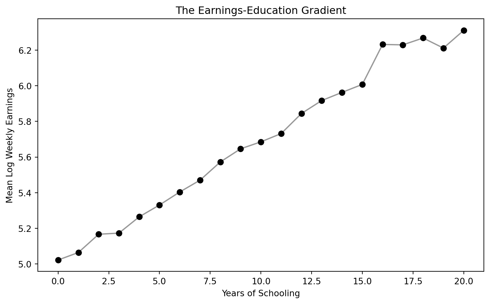
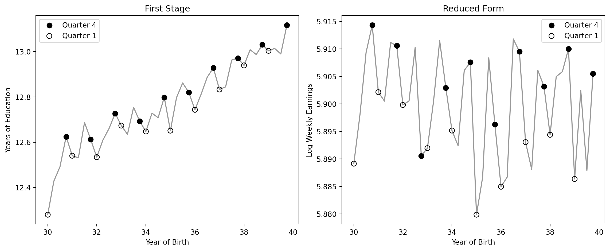
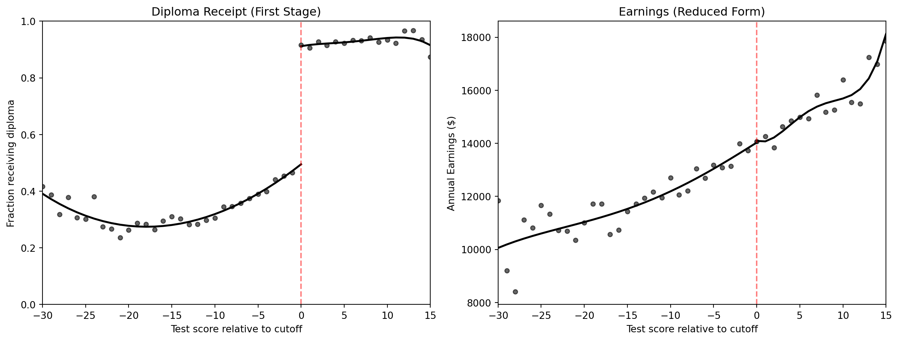
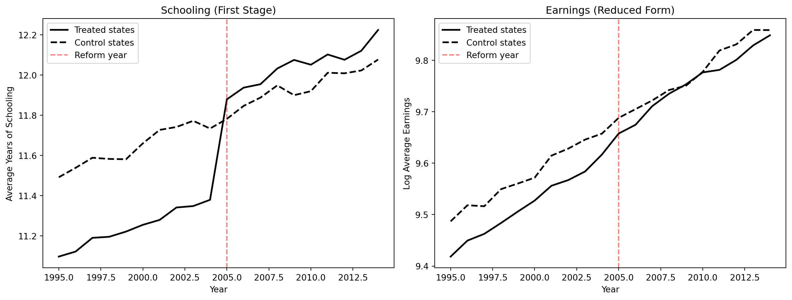

# The Question {.divider background-color="#3498db"}

[Act I]{.act}

## Does staying in school longer actually make you earn more?

College graduates earn roughly **twice** as much as high school graduates.

. . .

How much of that gap does school **cause** — and how much is about **who** chooses to stay in school?

::: {.notes}
Open with the stakes: families, students and governments spend enormous sums on education on the
premise that it pays. Ask the room: if you could pay for one extra year of school for a random
person, how much more would they earn? Keep the guesses on the board — we will test them with five
different research designs.
:::

## In the 1980 Census, each extra year of school goes with higher pay



[The gradient is steep and smooth. Is it a causal staircase, or a sorting of people by talent?]{.takeaway .fragment}

::: {.notes}
Each dot is the mean log weekly wage for one schooling level. Because the outcome is in logs, the
slope reads as a percentage gain per year. The picture is striking, but it is only a correlation:
people who stay in school longer may differ in ability, motivation and family background.
:::

## One regression puts a number on the gradient: about 7% per year

``` {.python code-line-numbers="1|3-5|7-8|9"}
!pip install -q pyfixest                  # pyfixest is not preinstalled in Colab
import pandas as pd                       # pandas → load tables
import pyfixest as pf                     # pyfixest → regressions with robust SEs

GITHUB_DATA_URL = "https://raw.githubusercontent.com/cmg777/intro2causal/main/data/"
qob = pd.read_csv(GITHUB_DATA_URL + "ch6/qob_clean.csv")   # 1980 Census, men born 1930–39

# log weekly earnings on years of schooling, robust (hetero) SEs
m = pf.feols("lnw ~ s", data=qob, vcov="hetero")
m.summary()                               # s: 0.0709 (0.0004) → ~7% per year
```

[↗ Try it in Colab](https://colab.research.google.com/notebooks/empty.ipynb){.colab-link target="_blank" data-preview-link="false"}

::: {.notes}
329,509 men, so the estimate is extremely precise: 0.0709 with a standard error of 0.0004
(t ≈ 186). Precision is not the issue. The question is what the coefficient measures. If more able
people both study longer and earn more, part of the 7% is ability, not school.
:::

## Our route through the chapter

::: {.incremental}
- **The question** — why a precise 7% correlation is not yet a causal return
- **The investigation** — ability bias, then five designs: twins, birth-quarter IV, child-labor-law
  IV, a diploma RD, and a policy DD
- **The resolution** — which estimates to trust, and why their agreement matters more than any one
:::

::: {.notes}
Learning objectives: estimate the simple OLS return and explain why it may overstate the causal
effect; apply the OVB formula to ability; explain why an RCT is infeasible; use twin fixed effects;
understand attenuation from measurement error; apply IV (twin reports, quarter of birth, compulsory
schooling laws); use RD to test sheepskin effects; read a DD with a policy change; compare all
estimates.
:::

## One question, five tools: each rung fixes a weakness of the one below

::: {.small-table}
| Rung | What it fixes | Its own weak spot |
|:---|:---|:---|
| OLS | — (the starting point) | Ability bias |
| Twin comparisons | Shared genes and upbringing | Noisy schooling reports |
| Birth-quarter IV | Ability **and** noise | Applies to would-be dropouts |
| Child-labor-law IV | A second, policy-driven source of variation | Weak instruments |
| Diploma RD | Asks: skills or the piece of paper? | Only local to the pass mark |
| Reform DD | Before-vs-after policy comparison | Needs parallel trends |
:::

[This chapter is a capstone: every method in the course, aimed at a single parameter.]{.takeaway .fragment}

::: {.notes}
OLS is the starting point, and we suspect it is biased. Twins remove shared ability but bring a
measurement-error problem; instruments fix that; the RD asks a sharper question (diploma vs skills);
the DD shows how a policy change can be used the same way. Plus a synthetic scholarship "RCT" as the
benchmark we cannot run in real life.
:::

## Three ideas carry the whole chapter

:::: {.columns}
::: {.column width="33%"}
### Return to schooling
$\rho$ — the percentage gain in earnings caused by **one more year** of school.
:::
::: {.column width="33%"}
### Ability bias
Able people study longer **and** earn more, so OLS credits school for talent.
:::
::: {.column width="34%"}
### Measurement error
Misreported schooling dilutes the signal and drags estimates **toward zero**.
:::
::::

[Ability pushes estimates up; noise pushes them down. The chapter is a tug-of-war between the two.]{.takeaway .fragment}

::: {.notes}
Other vocabulary as we go: omitted variables bias, bad control, twin fixed effects, reliability
ratio, instrument, first stage, reduced form, Wald estimator, LATE and compliers, weak instruments,
fuzzy RD, sheepskin effect, human capital vs signaling, parallel trends, convergence of evidence.
:::

# The Investigation {.divider background-color="#8e44ad"}

[Act II]{.act}

## The simple model hides ability inside the error term

$$\ln W_i = \alpha + \rho\, S_i + e_i$$

[$\ln W_i$ is log weekly earnings (`lnw`), $S_i$ years of schooling (`s`); ability, motivation and
family background all sit in $e_i$.]{.comment}

. . .

$$\hat\rho_{OLS} = \rho + \text{ability bias}$$

[If $S_i$ is correlated with what sits in $e_i$, OLS measures the return *plus* a bias.]{.takeaway .fragment}

::: {.notes}
Because the outcome is in logs, ρ = 0.07 means each year raises earnings by about 7%. The key
question is whether schooling is "as good as randomly assigned" with respect to everything in the
error. It almost certainly is not.
:::

## Ability raises both schooling and earnings, so OLS likely runs high

:::: {.columns}
::: {.column width="55%"}
```{mermaid}
graph TD
    A["Ability"] -->|"more school"| S["Schooling"]
    A -->|"higher pay"| W["Earnings"]
    S -.->|"causal return?"| W
    style A fill:#e67e22,color:#fff
    style S fill:#3498db,color:#fff
    style W fill:#2d8659,color:#fff
```
:::
::: {.column width="45%"}
$$\text{OVB} = \gamma \times \pi_1 > 0$$

- $\gamma$: ability's effect on earnings
- $\pi_1$: how ability tracks schooling
:::
::::

[Twist: if star talents drop out early to chase big opportunities, the bias could even turn negative.]{.takeaway .fragment}

::: {.notes}
The OVB formula from Chapter 2: the bias equals the effect of the omitted variable on the outcome (γ)
times its relationship with the regressor (π₁). Both are plausibly positive, so OLS overstates ρ.
The contrarian case: famous college dropouts who founded tech giants. They are rare, so the standard
upward-bias view probably holds for most people — but the sign is an empirical question.
:::

## Adding demographic controls barely moves the estimate

::: {.small-table}
| Twinsburg twins, OLS with controls | Coefficient (SE) |
|:---|---:|
| Years of education | [0.110 (0.010)]{.key} |
| Age | 0.104 (0.012) |
| Age squared (÷100) | −0.106 (0.015) |
| Female | −0.318 (0.040) |
| White | −0.100 (0.068) |
:::

[Age, gender and race are not ability — so ~11% per year still carries any ability bias.]{.takeaway .fragment}

::: {.notes}
This uses a different dataset — 680 twins from the Twinsburg festival in Ohio — so the 11% is not
directly comparable to the Census 7%. Code: pf.feols("lwage ~ educ + age + age2 + female + white",
vcov="hetero"). Observable controls only help if they capture the confounder; these don't.
:::

## When we can see ability, omitting it inflates the return by ~40%

| Synthetic data (true return 0.09) | Schooling coefficient (SE) |
|:---|---:|
| Short regression: omit ability | [0.1229 (0.0024)]{.key} |
| Long regression: include ability | 0.0853 (0.0036) |
| True causal return | 0.0900 |

[In real data ability is invisible, so the long regression is a luxury we never get.]{.takeaway .fragment}

::: {.notes}
2,000 simulated people whose data-generating process we wrote, so we know the truth (~0.09, combining
a direct effect and a channel through occupation). The short regression overshoots by roughly 40%;
adding ability recovers the truth. The lesson: we need a design that removes ability by construction.
:::

## Controlling for occupation blocks a real channel of the return

```{mermaid}
graph LR
    S["Schooling"] --> O["Occupation"]
    O --> W["Earnings"]
    S --> W
    style S fill:#3498db,color:#fff
    style O fill:#c0392b,color:#fff
    style W fill:#2d8659,color:#fff
```

Adding occupation shrinks the coefficient from **0.123** to **0.100** — not less bias, but a lost pathway.

[Never control for an outcome of the treatment: it is a bad control.]{.takeaway .fragment}

::: {.notes}
Occupation is caused by schooling: education opens doors to better-paying jobs. Holding occupation
fixed asks "what is the return among people in the same job?" — which removes one route through which
school raises pay. Same synthetic data as the previous slide.
:::

## The ideal experiment — randomizing schooling — is off the table

- Forcing some children to drop out is **unethical**
- Assigning years of school by lottery for decades is **impractical**

. . .

But a lottery for a **scholarship** that nudges schooling is imaginable — and shows what we are aiming for.

[We need designs that mimic random assignment without forcing anyone's education.]{.takeaway .fragment}

::: {.notes}
Random assignment would break the link between ability and schooling, making the simple comparison
causal — exactly as in Chapter 1. The scholarship idea previews the IV logic of the rest of the
chapter: a random push to schooling.
:::

## A scholarship lottery recovers the true return with a Wald ratio

| Synthetic scholarship lottery (true return 0.08) | Estimate |
|:---|---:|
| Scholarship → schooling (first stage) | 1.958 years |
| Scholarship → earnings (reduced form) | 0.1605 log points |
| Per-year return (reduced form ÷ first stage) | [0.0820]{.key} |

$$\hat\rho = \frac{\text{reduced form}}{\text{first stage}}$$

[A random push to schooling, scaled by how much schooling moved, isolates the return per year.]{.takeaway .fragment}

::: {.notes}
2,000 simulated people; half randomly offered a scholarship that adds about 2 years of school.
The offer is independent of ability and affects earnings only through schooling, so the ratio
0.1605 / 1.958 = 0.082 is close to the true 0.08. This is the Wald estimator of Chapter 3 — the
template every quasi-experiment below tries to imitate.
:::

## Comparing identical twins cancels shared genes and upbringing

$$\Delta Y_f = \rho\, \Delta S_f + \Delta e_f$$

[$\Delta Y_f$ is the wage gap within twin pair $f$ (`dlwage`); $\Delta S_f$ the schooling gap
(`deduc`). Anything both twins share drops out of the difference.]{.comment}

[If ability is shared within a pair, differencing removes ability bias by construction.]{.takeaway .fragment}

::: {.notes}
Twinsburg data: 340 pairs of identical twins interviewed at the annual twins festival in Ohio. If one
twin studied two more years than the other, their wage gap reflects schooling, not shared family or
genes. No intercept: twins with the same schooling should have no systematic wage gap.
:::

## Within twin pairs, the return falls to about 6%

| Method (Twinsburg twins) | Return to schooling (SE) |
|:---|---:|
| OLS with controls (levels) | 0.110 (0.010) |
| Twin fixed effects (differences) | [0.062 (0.020)]{.key} |

[Removing shared ability nearly halves the estimate — but is lower really closer to the truth?]{.takeaway .fragment}

::: {.notes}
The natural reading is "ability bias was inflating OLS". Hold that thought: differencing also
changes how much noise is in the schooling measure. The next slides show why the twin estimate can be
too low.
:::

## Twin fixed effects is one regression on within-pair differences

``` {.python code-line-numbers="1-3|5-6|8|9-11"}
!pip install -q pyfixest                  # pyfixest is not preinstalled in Colab
import pandas as pd                       # pandas → load tables
import pyfixest as pf                     # pyfixest → regressions with robust SEs

GITHUB_DATA_URL = "https://raw.githubusercontent.com/cmg777/intro2causal/main/data/"
twins = pd.read_csv(GITHUB_DATA_URL + "ch6/twins_clean.csv")   # Twinsburg twins

first = twins[twins["first"] == 1]        # keep one row per pair (no double counting)
# wage gap on schooling gap; "- 1" drops the intercept (equal school → no gap)
fe = pf.feols("dlwage ~ deduc - 1", data=first, vcov="hetero")
fe.summary()                              # deduc: 0.0617 (0.0198) → ~6%
```

[↗ Try it in Colab](https://colab.research.google.com/notebooks/empty.ipynb){.colab-link target="_blank" data-preview-link="false"}

::: {.notes}
Each pair appears twice in the file (once from each twin's perspective), so `first == 1` keeps one
row per pair: 340 observations. The differences are pre-computed (`dlwage`, `deduc`). The
measurement-error fix on the next slides is one line away:
pf.feols("dlwage ~ 0 | deduc ~ deduct", data=first[["dlwage","deduc","deduct"]].dropna(), vcov="hetero").
:::

## Differencing shrinks the signal but not the noise

$$\hat\rho_{FE} \approx \rho \times \underbrace{\frac{\text{Var}(\Delta S^*_f)}{\text{Var}(\Delta S^*_f) + \text{Var}(\Delta m_f)}}_{\text{reliability ratio}}$$

[$\Delta S^*_f$: true schooling gap within a pair · $\Delta m_f$: gap in reporting errors.]{.comment}

[Twins have similar schooling, so errors dominate — a reliability ratio of 0.5 would halve the estimate.]{.takeaway .fragment}

::: {.notes}
Bathroom-scale analogy: a scale that is off by a few pounds either way is fine for your weight, but
useless for measuring the half-pound you gained today — the difference between two readings is mostly
error. Same here: true schooling gaps within pairs are small, while misreports of a year or so stay the
same size. Attenuation bias pushes twin FE toward zero.
:::

## Using the co-twin's report as an instrument restores ~11%

| Method (Twinsburg twins) | Return to schooling (SE) |
|:---|---:|
| OLS (levels) | 0.110 (0.010) |
| Twin FE (differences) | 0.062 (0.020) |
| IV with co-twin's report (levels) | [0.116 (0.011)]{.key} |
| IV with co-twin's report (differences) | [0.108 (0.034)]{.key} |

[An independent second measurement filters out the noise — and the return climbs back to ~11%.]{.takeaway .fragment}

::: {.notes}
Each twin also reported the other's schooling. That report tracks true schooling but has its own,
independent error, so it is a valid instrument for own-reported schooling. pyfixest syntax:
`| educ ~ educt_t` (levels) or `| deduc ~ deduct` (differences). Once noise is corrected, the
within-pair return is close to OLS — suggesting ability bias in OLS is modest here.
:::

## Twins solve one problem but leave two caveats

:::: {.columns}
::: {.column width="50%"}
### Who is in the sample?
Twins who attend a **festival** in Ohio are self-selected — they may not represent all workers.
:::
::: {.column width="50%"}
### Are the errors independent?
If twins **agree** on a wrong answer, their reports share errors and the IV fix weakens.
:::
::::

[Twin designs are clever but fragile; we need variation in schooling that is precisely measured.]{.takeaway .fragment}

::: {.notes}
External validity and the independence of measurement errors are both untestable here. The next
strategy uses Census data where schooling is recorded for hundreds of thousands of men and the source
of variation has nothing to do with ability: the calendar.
:::

## Birth timing plus dropout laws keeps Q4 babies in school longer

```{mermaid}
graph LR
    Q["Born in Q4"] --> Y["Starts school younger"]
    Y --> S["More school by age 16"]
    S --> W["Higher earnings"]
    style Q fill:#8e44ad,color:#fff
    style Y fill:#2c3e50,color:#fff
    style S fill:#3498db,color:#fff
    style W fill:#2d8659,color:#fff
```

[1980 Census: 329,509 men born 1930–1939 (Angrist and Krueger, 1991). Instrument: born in the fourth quarter (`q4`).]{.comment}

[Birth quarter is unrelated to ability, but it shifts how much school a would-be dropout completes.]{.takeaway .fragment}

::: {.notes}
School-entry rules use a birthday cutoff, so children born late in the year start school slightly
younger. Compulsory attendance lets students leave at 16 — and a Q4 child reaches 16 having completed
a bit more school. Exclusion restriction: birth quarter affects earnings only through schooling.
:::

## Q4 births get slightly more school — and slightly higher pay



[The same saw-tooth appears in both panels: the first stage and the reduced form line up.]{.takeaway .fragment}

::: {.notes}
Within each birth year, the filled Q4 dots tend to sit above the hollow Q1 dots — in schooling (first
stage) and, more noisily, in earnings (reduced form). The upward trend in schooling across cohorts is
absorbed by comparing quarters within a year.
:::

## Dividing the reduced form by the first stage gives about 7%

| Step | Estimate (SE) |
|:---|---:|
| Reduced form: Q4 → log earnings | 0.0068 (0.0027) |
| First stage: Q4 → years of school | 0.0921 (0.0132) |
| Wald ratio (reduced form ÷ first stage) | [0.0740]{.key} |
| 2SLS | 0.0740 (0.0280) |

[A tenth of a year of extra school, worth 0.7% more pay, implies a return of about 7% per year.]{.takeaway .fragment}

::: {.notes}
The instrument is strong: first-stage F ≈ 48, far above the rule-of-thumb 10. The IV estimate (7.4%)
is close to OLS (7.1%) but far less precise (SE 0.028 vs 0.0004) — the price of using only the
variation the instrument creates.
:::

## Three regressions and a ratio reproduce the birth-quarter IV

``` {.python code-line-numbers="1-3|5-6|8-10|11-12"}
!pip install -q pyfixest                  # pyfixest is not preinstalled in Colab
import pandas as pd                       # pandas → load tables
import pyfixest as pf                     # pyfixest → OLS and IV/2SLS

GITHUB_DATA_URL = "https://raw.githubusercontent.com/cmg777/intro2causal/main/data/"
qob = pd.read_csv(GITHUB_DATA_URL + "ch6/qob_clean.csv")   # 1980 Census, men born 1930–39

fs = pf.feols("s ~ q4", data=qob, vcov="hetero")     # first stage: Q4 → schooling (0.092)
rf = pf.feols("lnw ~ q4", data=qob, vcov="hetero")   # reduced form: Q4 → earnings (0.0068)
print(rf.coef()["q4"] / fs.coef()["q4"])             # Wald ratio = 0.074
iv = pf.feols("lnw ~ 1 | s ~ q4", data=qob, vcov="hetero")   # 2SLS: s instrumented by q4
iv.summary()                              # s: 0.0740 (0.0280) — same as the Wald ratio
```

[↗ Try it in Colab](https://colab.research.google.com/notebooks/empty.ipynb){.colab-link target="_blank" data-preview-link="false"}

::: {.notes}
The IV formula reads: outcome ~ exogenous controls | endogenous ~ instrument. With one binary
instrument and no controls, 2SLS equals the Wald ratio exactly; 2SLS also gives the correct standard
error. First-stage F for a single instrument = t² of q4 in the first stage ≈ 48.
:::

## The IV return applies to students at the dropout margin

:::: {.columns}
::: {.column width="50%"}
### Compliers
Would-be dropouts whose schooling **was** changed by their birth quarter — the LATE is *their* return.
:::
::: {.column width="50%"}
### Not compliers
College-bound students and very early leavers: their schooling **does not** depend on birth quarter.
:::
::::

[7% is the return for students on the edge of leaving school — not necessarily for future graduates.]{.takeaway .fragment}

::: {.notes}
Local average treatment effect (Chapter 3). Always-takers (would stay regardless) and never-takers
(leave regardless of the rules) contribute nothing to the estimate. The return for other groups could
be higher or lower — heterogeneous effects.
:::

## State laws on school-entry age provide a second set of instruments

$$S_{scy} = \phi_1 CL7_{sc} + \phi_2 CL8_{sc} + \phi_3 CL9_{sc} + \beta_s + \gamma_c + \delta_y + v_{scy}$$

[$CL7, CL8, CL9$: state required school entry by age 7, 8 or 9 (`cl7`, `cl8`, `cl9`) · $\beta_s$ state of
birth · $\gamma_c$ birth cohort · $\delta_y$ census year — all absorbed as fixed effects.]{.comment}

[Laws differ across states and cohorts, so a child's required schooling depends on where and when they were born.]{.takeaway .fragment}

::: {.notes}
Acemoglu and Angrist: data collapsed to state-of-birth × year-of-birth × census-year cells (about
2,400 cells), weighted by cell size, with standard errors clustered by state. The second stage
regresses log weekly wages on predicted schooling with the same fixed effects.
:::

## The child-labor-law IV doubles the return: 13% vs 7%

| Method (state, cohort, census-year FE) | Return to schooling (SE) |
|:---|---:|
| OLS | 0.0698 (0.0066) |
| IV / 2SLS (entry-age laws as instruments) | [0.1288 (0.0371)]{.key} |

[The instrumented return is larger than OLS — the opposite of what pure ability bias predicts.]{.takeaway .fragment}

::: {.notes}
One reading: the compliers here (children pushed into school by the laws) may have unusually high
returns. Another: measurement error was biasing OLS down. But the standard error is large — the 95%
interval runs from roughly 5% to 20% — and the next slide explains why we should be cautious.
:::

## A first-stage F of 6 signals weak instruments

| First stage: instrument → years of school | Coefficient (SE) |
|:---|---:|
| Entry required by age 7 | 0.1690 (0.0674) |
| Entry required by age 8 | 0.1872 (0.0621) |
| Entry required by age 9 | 0.3973 (0.0984) |
| Joint F-statistic | [6.06]{.key} |

[Below the rule-of-thumb of 10, IV estimates are imprecise and can be biased — read 13% with caution.]{.takeaway .fragment}

::: {.notes}
Each instrument is individually significant, but together they explain too little of the schooling
variation once all the fixed effects are absorbed. Compare the birth-quarter first stage, F ≈ 48.
Weak instruments widen confidence intervals and make the estimate sensitive to small violations.
:::

## Fixed effects, weights and clusters fit in one IV formula

``` {.python code-line-numbers="1-3|5-6|8-10|11"}
!pip install -q pyfixest                  # pyfixest is not preinstalled in Colab
import pandas as pd                       # pandas → load tables
import pyfixest as pf                     # pyfixest → IV with absorbed fixed effects

GITHUB_DATA_URL = "https://raw.githubusercontent.com/cmg777/intro2causal/main/data/"
cl = pd.read_csv(GITHUB_DATA_URL + "ch6/childlabor_clean.csv")  # state × cohort × census cells

# controls | fixed effects | endogenous ~ instruments; cell-size weights; cluster by state
iv = pf.feols("lnwkwage ~ 1 | sob + yob + year | indEduc ~ cl7 + cl8 + cl9",
              data=cl, weights="weight", vcov={"CRV1": "sob"})
iv.summary()                              # indEduc: 0.1288 (0.0371) vs OLS 0.0698
```

[↗ Try it in Colab](https://colab.research.google.com/notebooks/empty.ipynb){.colab-link target="_blank" data-preview-link="false"}

::: {.notes}
Three parts separated by pipes: exogenous controls (just an intercept), absorbed fixed effects
(state of birth, year of birth, census year), and the IV part. The OLS comparison drops the IV part:
pf.feols("lnwkwage ~ indEduc | sob + yob + year", data=cl, weights="weight", vcov={"CRV1": "sob"}).
The first stage is the same call with indEduc on the left and cl7 + cl8 + cl9 on the right.
:::

## Skills or the piece of paper? Two theories predict different jumps

:::: {.columns}
::: {.column width="50%"}
### Human capital
School builds **skills**. Students just above and below a pass mark have the same skills → **no** earnings jump.
:::
::: {.column width="50%"}
### Signaling
The diploma **signals** ability to employers. Holding it should pay → an earnings **jump** at the pass mark.
:::
::::

[Texas last-chance exit exam (Clark and Martorell, 2014): 46 score bins around the passing line.]{.comment}

[An RD at the exam cutoff tests the value of the credential itself — the sheepskin effect.]{.takeaway .fragment}

::: {.notes}
"Sheepskin" because diplomas were once printed on it. The running variable is the score relative to
the pass mark (`minscore`, 0 = cutoff). Students one point either side are near-identical in skills
but very different in their chance of getting a diploma. RD model: Y = α + ρD + f(score) + e, with
a separate quartic in the score on each side of the cutoff.
:::

## Passing raises diploma receipt sharply; earnings barely notice



[A big jump on the left, almost none on the right: the credential changes hands, the paycheck doesn't.]{.takeaway .fragment}

::: {.notes}
Diploma receipt jumps from about half to over 90% at the cutoff. Earnings rise smoothly with the
score — higher-scoring students earn more because they have more skills — with no visible break at
the line.
:::

## The diploma jumps ~42 points, but earnings move only ~$60

| Jump at the passing score (quartic on each side) | Estimate (SE) |
|:---|---:|
| Diploma receipt (share) | 0.417 (0.011) |
| Annual earnings (\$) | [62 (284)]{.key} |
| Earnings level just below the cutoff (\$) | ~14,000 |

[The credential alone adds almost nothing — the premium comes from what students learn.]{.takeaway .fragment}

::: {.notes}
Re-run of the chapter's RD fits: separate quartic polynomials in the score on each side, weighted by
cell size (diploma) or person-years (earnings), robust SEs. Because passing raises diploma receipt by
~42 points rather than 100, this is a fuzzy RD; scaling the earnings jump by the diploma jump
(62 / 0.417 ≈ $150) still gives a negligible, statistically insignificant credential effect.
Code: pf.feols("avgearnings ~ pass_exam + left_1 + … + right_4", data=sheep, weights="person_years", vcov="hetero").
:::

## A schooling reform in half the states shows parallel pre-trends



[Before 2005 the two groups move in parallel; after, reform states jump in schooling and their earnings catch up.]{.takeaway .fragment}

::: {.notes}
Synthetic dataset designed to illustrate DD: 20 states × 20 years (1995–2014). Parallel trends in
the pre-period make the comparison states a credible counterfactual for what reform states would
have done without the law. A placebo DD with a fake reform in 2000 gives 0.0089 (SE 0.0111) —
no spurious effect.
:::

## DD on earnings ÷ DD on schooling gives a return of about 8%

| Two-way fixed-effects DD (state + year FE) | Estimate (SE) |
|:---|---:|
| Reform → years of school ("first stage") | 0.5039 (0.0165) |
| Reform → log earnings ("reduced form") | 0.0393 (0.0055) |
| Implied return per year (ratio) | [0.0779]{.key} |

[It is the same policy variation the child-labor-law IV uses — now read as before-vs-after.]{.takeaway .fragment}

::: {.notes}
DD model: Y_st = α + δ(Treated_s × Post_t) + β_s + γ_t + e_st, run twice — once for schooling and once
for earnings. The ratio is a Wald estimator built from two DDs, valid if the reform affects earnings
only through schooling. Synthetic data, so treat the 7.8% as an illustration, not a finding.
:::

## Two-way fixed effects and a ratio give the DD return

``` {.python code-line-numbers="1-3|5-6|8|9-12"}
!pip install -q pyfixest                  # pyfixest is not preinstalled in Colab
import pandas as pd                       # pandas → load tables
import pyfixest as pf                     # pyfixest → two-way fixed-effects DD

GITHUB_DATA_URL = "https://raw.githubusercontent.com/cmg777/intro2causal/main/data/"
did = pd.read_csv(GITHUB_DATA_URL + "ch6/synthetic_did.csv")   # 20 states × 20 years

did["treat_post"] = did["treated"] * did["post"]   # 1 = reform state after 2005
# DD with state and year fixed effects; cluster SEs by state
s = pf.feols("avg_schooling ~ treat_post | state + year", data=did, vcov={"CRV1": "state"})
e = pf.feols("avg_earnings ~ treat_post | state + year", data=did, vcov={"CRV1": "state"})
print(e.coef()["treat_post"] / s.coef()["treat_post"])   # implied return: 0.078
```

[↗ Try it in Colab](https://colab.research.google.com/notebooks/empty.ipynb){.colab-link target="_blank" data-preview-link="false"}

::: {.notes}
`| state + year` absorbs state and year fixed effects, so treat_post's coefficient is the DD.
Clustering by state allows each state's errors to be correlated over time. s.coef() ≈ 0.504 years,
e.coef() ≈ 0.039 log points.
:::

## Side by side, the designs bracket the return to schooling

::: {.small-table}
| Design | Data | Return per year | Main weak spot |
|:---|:---|---:|:---|
| Simple OLS | 1980 Census | 0.071 | Ability bias (up) |
| OLS + controls | Twins | 0.110 | Ability bias (up) |
| Twin fixed effects | Twins | [0.062]{.key} | Noisy reports (down) |
| Twin IV (levels / diffs) | Twins | 0.116 / 0.108 | Shared misreports |
| Birth-quarter IV | 1980 Census | [0.074]{.key} | LATE for dropouts only |
| Child-labor-law IV | Census cells | 0.129 | Weak IV ($F = 6$) |
| Reform DD | Synthetic | 0.078 | Parallel trends |
| Diploma RD | Texas | ≈ 0 (credential) | Diploma only, not years |
:::

[Each design fails differently, yet all point to a sizable return — roughly 7–10% per year.]{.takeaway .fragment}

::: {.notes}
Twin FE sits lowest (noise drags it down); the noise-corrected twin IV and the weak child-labor IV sit
highest; the precise Census designs (OLS and birth-quarter IV) cluster near 7%. The RD answers a
different question: the diploma itself is worth almost nothing, so the return is about learning.
The chapter's best read is a causal return of roughly 7–10% per year.
:::

# The Resolution {.divider background-color="#2d8659"}

[Act III]{.act}

## The tempting mistake: "Twin FE is lowest, so it must be closest to the truth"

[Objection.]{.objection} Differencing removes ability, so the smallest estimate (6%) is the cleanest.

. . .

[Response.]{.rebuttal} Differencing also magnifies reporting errors. Once the co-twin's report
corrects the noise, the within-pair return climbs back to about 11%. Lower is not the same as less
biased.

::: {.notes}
Two biases pull in opposite directions: ability pushes OLS up, measurement error pushes twin FE down.
A good empiricist asks which biases each design suffers from — not which number is smallest.
:::

## The tempting mistake: "No diploma jump means school does not pay"

[Objection.]{.objection} At the Texas cutoff the diploma barely changes earnings, so education is
worthless.

. . .

[Response.]{.rebuttal} The RD prices the **paper**, not the years. Earnings still rise steadily with
skills, and the IV designs find 7%+ per year — school pays through learning, not the credential.

::: {.notes}
The sheepskin RD is evidence for human capital over signaling — not evidence against a return to
schooling. Different designs answer different questions; read each one for what it identifies.
:::

## Key takeaways

::: {.incremental}
- Raw OLS (~7%) mixes the causal return with **ability bias**
- **Twins** remove shared ability but magnify **reporting errors** (6%)
- **Instruments** correct the noise and point to roughly **7–10%**
- The **diploma itself** is worth little; learning drives the premium
- Trust **convergence** across designs with different weak spots
:::

::: {.notes}
Tie back to the opening guesses. The causal return to a year of school is real and large — roughly
7–10% per year — and we believe it not because any one design is flawless, but because designs with
different assumptions and different flaws land in the same neighbourhood.
:::

## {.recap background-image="figures/visual_summary.webp" background-size="contain" background-color="#061525"}

::: {.notes}
Recap with the chapter's visual summary: the question (does school cause higher pay?), the problem
(ability bias, then measurement error), the five designs (twins, birth-quarter IV, child-labor-law IV,
diploma RD, reform DD), and the synthesis (a convergent 7–10%).
:::

# When five imperfect designs agree, a year of school raises earnings by roughly 7–10%. {.divider background-color="#2d8659"}
